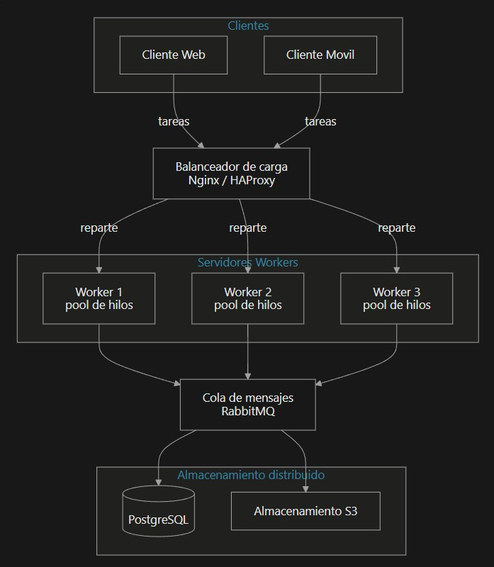
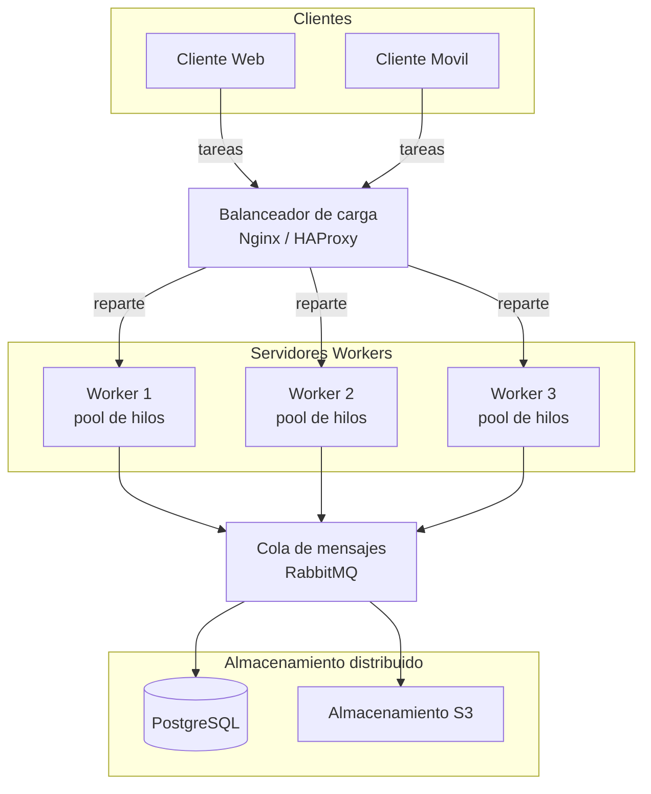
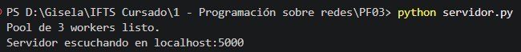
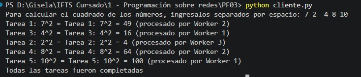
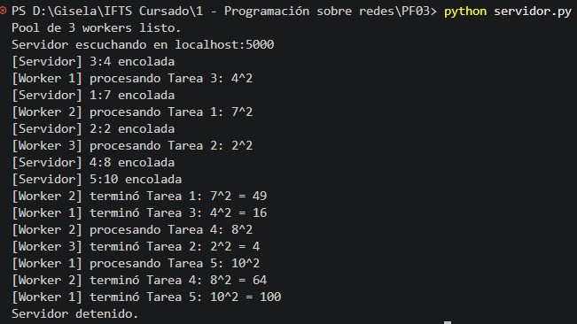

# PFO 3 - Rediseño como Sistema Distribuido (Cliente-Servidor)

Trabajo práctico de la materia **Programación sobre Redes**.

El objetivo es transformar el sistema en una arquitectura distribuida usando
sockets. Un servidor recibe **tareas** por socket y las reparte a un **pool de
workers** (hilos) que las procesan en paralelo; un cliente envía varias tareas y
recibe el **resultado** de cada una.

---

## Requisitos

- Python 3

No requiere instalar librerías externas: usa solo módulos de la librería estándar
(`socket`, `threading`, `queue`, `time`).

---

## Cómo ejecutar

El proyecto tiene dos programas que se ejecutan por separado, cada uno en su
propia terminal.

### 1. Servidor

```
python servidor.py
```

Crea el pool de workers y queda escuchando en `localhost:5000`.

### 2. Cliente (en otra terminal)

```
python cliente.py
```

Pide varios números separados por espacio (por ejemplo: `3 4 5 6 7`), los envía
como tareas y muestra el resultado de cada una.

Para detener el servidor, usar `Ctrl+C` en su terminal.

---

## Diagrama del sistema





---

## Qué parte del diagrama implementa el código

El código entregado es una **versión simplificada** de la arquitectura del 
diagrama. Implementa el núcleo del sistema (cliente, cola de tareas y pool de
workers); el balanceador de carga y el almacenamiento representan el diseño ideal
a mayor escala y no se programan.

| Pieza del diagrama                    | ¿En el código? | Dónde                                                                     |
|---------------------------------------|----------------|---------------------------------------------------------------------------|
| Clientes (web, móvil)                 | Sí             | `cliente.py` (representa a cualquier cliente)                             |
| Servidores workers (pool de hilos)    | Sí             | `servidor.py`: función `worker()` + el pool creado con `threading.Thread` |
| Cola de mensajes (RabbitMQ)           | Sí (simulada)  | `servidor.py`: `cola = queue.Queue()` (en memoria)                        |
| Balanceador de carga (Nginx/HAProxy)  | No             | Solo en el diagrama                                                       |
| Almacenamiento (PostgreSQL, S3)       | No             | Solo en el diagrama                                                       |

El flujo real del código es: **cliente → cola → worker → responde al cliente**.
Todo lo que está dentro de ese flujo está programado; el balanceador (antes del
cliente) y el almacenamiento (después del worker) son parte del diseño ideal.

---

## Cómo funciona

1. El **servidor** crea un pool de 3 workers (hilos) que quedan esperando tareas
   en una cola compartida (`queue.Queue`).
2. Cada **cliente** se conecta por socket y envía una tarea (un número).
3. El servidor recibe la tarea y la **mete en la cola** (`cola.put`). El hilo
   principal solo recibe y encola, así nunca se bloquea.
4. Un **worker libre** saca la tarea de la cola (`cola.get`), la procesa
   (simula trabajo con `time.sleep`), calcula el resultado y se lo **devuelve al
   cliente** por la misma conexión.
5. El cliente recibe el resultado y lo muestra.

Como hay 3 workers, se procesan hasta 3 tareas al mismo tiempo. Si llegan más,
esperan en la cola hasta que se libere un worker. Esto es lo que demuestra la
distribución de tareas entre workers.

---

## Capturas de pantalla

### Servidor iniciado
 
El servidor arranca, crea el pool de 3 workers y queda escuchando en
`localhost:5000`.
 

 
### Cliente enviando varias tareas
 
El cliente envía varios números a la vez. Cada tarea vuelve con su resultado
(el cuadrado del número) y el worker que la procesó.
 

 
### Procesamiento en paralelo
 
En el servidor se ve cómo las tareas se encolan y los 3 workers las procesan en
paralelo: las primeras tres al mismo tiempo, y las demás esperan a que se libere
un worker.
 



---

## Autor

Gisela Croci - IFTS - Programación sobre Redes
